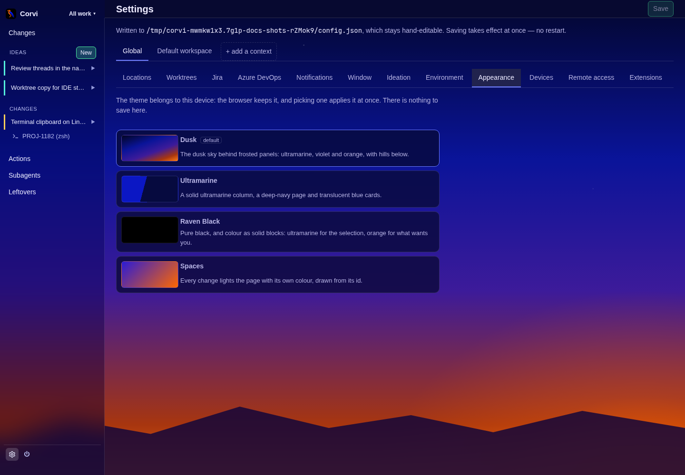

# The interface


## Navigation

At the top of the left column is the brand row: the raven and **Corvi**. Below it are the change
overview, ideas, active changes and their terminal windows. The workspace switcher sits beside the
**Workspace** heading, with the pages that belong to that context. A waiting
agent shows as the change's dot in the list and on its terminal tab, not as an entry of its own.
At the bottom sit Settings — a gear — the power control (see [Power down when
done](terminals.md#power-down-when-done)), the terminal host's restart icon, and the update icon:
yellow when a new version of the app is waiting, grey when there is none, and absent when this run
cannot update itself (see
[install](install.md#updates)). The restart icon is absent unless the running terminal host is not
the one this server would have started — another checkout's, or another build's — and it asks
before it ends anything (see [terminals](terminals.md#sessions-and-attachment)). The column is
resizable and remembers
its width in the browser. On a narrow window it becomes an overlay drawer instead: a toggle opens
and closes it, as do choosing something, clicking the backdrop, pressing Escape, and widening the
window. While it is closed the content owns the window, rather than sitting below the column.

Ideas are separate from work in progress. An unfinished wizard appears as **New idea** or the
title you typed; opening it restores its draft. Only one destination is highlighted: a terminal
window, a change view, or the draft being edited.

Selecting a change opens its **Plan** — the first of its views. **Plan**, **Dashboard** and
**Changes** are views of that change; its terminal windows are tabs in the same row and
can also be opened directly from the navigation column. Each view has a URL, so deep links,
reload, and browser Back work.
Coming back to a change's overview — from a terminal window, or by opening the change again —
lands on the view you last had open there, within the running app: restarting opens the plan
again. Leaving Settings with unsaved edits asks first however you go — clicking or Back — see
[configuration](configuration.md).

A terminal window is created only by an explicit open. **+**, or its leader key, opens the dialog
that creates one, normally in the current window's working directory, and the window it opens
becomes the current one; a change with no window shows only that **+** and one line saying there is
no terminal yet, and nothing is started just by arriving at the page. Opening a dashboard does not
start a terminal either. Background work that opens a window — an action run, a subagent — leaves
the terminal you are looking at selected.

A remote workspace that cannot be reached stays selectable in the workspace menu; the menu and
the selected workspace's label suffix it **(Unavailable)**, while its retained changes, windows
and subagent entries stay in the navigation column without a suffix of their own. Its last known
data is what you see until it recovers (see
[configuration](configuration.md#remote-workspaces-that-are-unavailable)).

## Keyboard

Everything the column offers, and the controls of a change and of the wizard, can be reached from
the keyboard without memorizing a list: press `Ctrl+Space` and each of those controls grows a small
keycap — the column's entries along `Q W E R T Y U I O P` from the top down, the current view's
controls along `A S D F G H J` from the left, and the column's bottom row on `Z X C V`. The keys
follow where the controls are, not what they are called, so they move with the layout and a control
that is not there takes no key. In the column they share one lane, so the keys read as a single
rail however far each entry reaches. Press one and it does what the control does. On the pages with
no keys of their own — the overview, Actions, Subagents, Settings — the column's keys are still the
way around.

The groups are picked from a key on the group itself: `E` sits at the middle of the **Ideas** list,
`R` at the middle of **Changes** (an open menu is numbered as soon as it appears). A group is boxed
while the keys are showing, and a group with nothing in it takes no key and no box. A group with one
item goes straight to it; a longer one is numbered `1`–`9` and `0`, with the arrows to walk it and
`Enter` to choose. Picking an idea or a change leaves the keys up — it is somewhere to go, so the
next key is the view or terminal you were on your way to. A terminal or a menu item ends the mode,
because that is where you type or where the action is. The view's own keys sit above their
control's trailing corner, in the line over the tabs, where the label under them stays readable.

In a change's row `F` is **+**, and its dialog opens with the keys it answers to showing; `G` over
the window tabs opens **Select terminal**, the change's windows one row each with the icon, the
name and where it is. A digit `1`–`9` picks a row (`0` the tenth), the arrows walk the list, `Enter`
opens the row they are on, and `Esc` closes it without moving. With no windows there is nothing to
pick, so the entry takes no key.

`Escape` puts a layer away at a time — a number selection, then an open menu, then the keycaps
themselves — and `Ctrl+Space` leaves the mode outright. `[` and `]` are Back and Forward while the
keys are showing. A key that has nothing mapped does nothing. The mode does not open while a dialog
is: that dialog's own keys are the whole surface then. On a narrow window the column opens as the
drawer while the keys are up.

The terminal's own chords — find, font size, copy and paste — are on its cheat sheet, which
carries this section's keys too (see [terminals](terminals.md)). A new terminal is opened with
**+** or its leader key, and the change's windows with the key over their tabs; the terminal has no
new-window chord of its own.

`Ctrl+Space` is the whole app's, terminals included, so it never reaches a shell. An input method
may claim it first: on macOS the system offers it for **Select the previous input source** when
more than one input source is installed (turn it off in System Settings → Keyboard → Keyboard
Shortcuts → Input Sources), and on Linux fcitx5 and IBus commonly use it to switch the input
method. With either one holding the key, the mode never opens: rebind the trigger, or turn it off,
in the input method's own settings.

## Settings

The settings page edits the config file directly; [configuration](configuration.md) documents the
keys and the scopes. Its sections sit in a tree on the left:

- **Workspace**: **Contexts**, **Locations**, **Worktrees**, **Ideation** and **Environment**.
- **Appearance & Behavior**: **Appearance**, **Window** and **Notifications**.
- **Extensions**: one row per extension that declares settings, in the order they loaded.
- **Remote**: **Remote access** and **Devices**.

A filter above the tree narrows it by name. Every group starts open, and its `−`/`+` control
closes and opens it; while a filter is active the matching groups open, so a match is never hidden.
The group rows are selectable too: a pure group says there are no settings at that level, while
**Extensions** shows the enable/disable switches for the scope. The chosen section opens on the
right under its breadcrumb — `Appearance & Behavior › Window` — and the scope tabs live inside that
detail view: **Global** and one tab per workspace. The scope is sticky, so walking the tree never
changes it. Sections that belong to no workspace — **Appearance**, **Remote access**, **Devices** —
have no scope tabs, and **Workspace → Contexts** is workspace-only: it shows the workspace tabs and
**+ add a context**, and with **Global** selected it says that contexts are workspace-specific.

Four sections behave differently from the settings around them:

- **Appearance & Behavior → Appearance** (global scope): the five themes and the monospace font,
  applied as soon as they are chosen. Both belong to this device, not to the config file, so this
  section has no **Save**; see [Themes](#themes) and [Monospace font](#monospace-font).
- **Remote → Remote access** (global scope): **Enable remote access** and the listener's **Port**
  ride the draft and are written by **Save**. The Tailscale block publishes the listener to the
  tailnet — **Publish to Tailscale** / **Stop publishing** — shows the published URL, and says why
  it cannot publish (not installed, not connected, 443 already in use, or a 443 tree shared with
  another handler, in which case it spells out the manual `tailscale serve --https=443 off`). See
  [remote access](install.md#remote-access).
- **Remote → Devices** (global scope): create a short-lived, single-use **pairing code** — shown
  with its countdown — and list the paired devices with **Revoke**. No token is ever displayed. See
  [remote access](install.md#remote-access).
- **Workspace → Contexts** (workspace-only): a workspace's Name and Id, and ticking **Hosted on
  another server** drops that workspace's local settings and shows its **Remote address**,
  **Remote workspace** and **Device token** fields, a **Pair** control (a pairing code and a device
  name) that runs the pairing against that server and fills the token, and — once paired — a picker
  of the remote's workspaces. Changing the address or the remote workspace id while a token is
  stored warns that the stored token no longer applies, and **Save** drops it, so the new target
  has to be paired again. Unticking the box switches it back to local; **Remove this context**
  deletes it. See [workspaces](configuration.md#workspaces).

A remote workspace still appears in the scope tabs of the other scoped sections, but selecting it
shows a note that its settings live on the server that hosts it, rather than drawing local fields.

## Themes



Corvi ships five dark themes, chosen in **Settings → Appearance & Behavior → Appearance**:

- **Dusk** (the default): the dusk sky behind frosted panels.
- **Ultramarine**: a solid ultramarine navigation column, a deep-navy page and translucent blue
  cards.
- **Raven Black**: pure black, with colour as solid blocks — the selection ultramarine, what wants
  you orange, and a change's state a filled chip.
- **Spaces**: every change lights the page with its own colour pair, derived from its id. Ideas and
  the changes overview keep Corvi's own pair — ultramarine and orange.
- **Classic**: Corvi before the redesign — graphite surfaces, one blue accent, and no sky, glass
  or glow.

The choice is per device rather than part of `config.json`: it is kept in a browser cookie, so it
applies to this browser on this machine and survives a restart. Picking a theme applies it at once;
another tab that is already open keeps the theme it loaded with until it is reloaded.

A theme is a set of the design tokens in `apps/web/src/app-root/styles.css`, and that file is the
only place a colour is written down. All five themes are dark (`color-scheme: dark`). A terminal's
well stays opaque in every theme, and the menus and find bar that float over it are opaque too, so
no backdrop blur runs behind a terminal. In Dusk the sky moves with the pointer, by at most 12 by 8
pixels; reduced motion — including switching that preference on mid-session — stops it. In Spaces,
switching changes glides from one pair to the next, while arriving at a change from a cold link
paints its colour instead of animating it.

## Monospace font

Terminals, the plan editor, diffs and identifiers share one monospace font. By default it is the
system's (SF Mono or Menlo on macOS). **Settings → Appearance & Behavior → Appearance → Monospace
font** puts an installed font in front of it: type the family name as the system lists it — Font
Book on macOS, `fc-list : family` on Linux; the info icon beside the field says the same. A name
that is not installed falls back to the default. Like the theme, the choice is kept in a cookie for
this device and applies at once; a terminal picks it up when it is next shown.

Programs in a terminal often print [Nerd Fonts](https://www.nerdfonts.com) icons — pi's footer,
prompts, file listings. Those are private-use characters no system font draws, so Corvi serves the
Nerd Fonts symbols font (`Symbols Nerd Font Mono`) after the text faces, whatever font is chosen.
`bun install` fetches it, pinned by version and checksum, into `apps/web/fonts` with its licences.
When that fetch failed (no network during install) the page works as before, the icons show as
boxes, and the Appearance section says so; `bun run fonts` then `bun run build:web` fixes it.

## Change views

Every change page begins with a **title row**: the change's name, id and branch on the left, and
its state selector and **Actions** menu on the right — a finished change shows how it ended and,
when cancelled, **Reopen** instead of that menu. Renaming is the menu's **Rename change**
entry, which opens a field in place of the name. Under the title row is the change's one **tab
row**: **Plan**, **Dashboard**, **Changes** and any other tab an extension contributes, a
separator, then **+** for a new window and the change's terminal windows with their status marks.
A window you open takes the leading place in that group; background work — an action run, a
subagent — appears at its end.
In the desktop app the title row is the window's title bar — the part you drag the window by — and
the tab row under it is not part of that drag area. The **Plan** tab is
`PLAN.md` as Markdown source filling the tab — the markup stays visible, in a monospace face,
colored as an editor colors it. Tab indents in the editor (Escape, then Tab, moves focus on
instead). The text follows the file when it changes outside Corvi — an agent or an IDE editing
it — and when edits are in flight it asks before either version goes away. How far into the plan
you were is remembered as you move around, within the running app. The dashboard places notes
documents in the left column and status cards in the right; narrow windows stack the documents
first. Its columns run to the bottom of the window and the last card in each grows into the
leftover height, so the page does not end in an empty band under the cards; a wrapped tab row, a
notice or an error banner takes its height from the cards rather than pushing them past the
window. Status cards load independently, so one slow integration does not block the whole page.
The dashboard's **Subagents** card lists the change's subagent sessions, attached or not: each row
says whether its window is live and how busy it is, and carries the one action it
needs — **Open** a closed one, **Close** a live one, **Continue** an interrupted turn. Open brings
the recreated window to the front and takes you to the terminal page, where the subagent is an
ordinary window of the change. A change with no subagents has no card. Returning to a view can
show cached data while it refreshes.

When the workspace a page shows is unavailable, one banner row sits above the content naming it
and its reason, with **Retry now** and **Local settings**. Below it the retained data stays
readable and read-only, under that banner: the overview cards and the change header carry the
stale marker, and everything else — documents, cards, windows and the subagent card — keeps its last
known state without a marker of its own. Nothing is emptied. A draft typed before the connection
was lost is held (the plan and notes editors become read-only), and recovery does not itself save
it: resuming the edit, or an explicit save, follows the normal save policy. The change's phase
selector and the action menus are held back until it recovers.

The title row's **Actions** menu is the change's and the window's at once: **Harnesses…** opens
the change's shell-pane and subagent harness choices; the change's endings
first, then the actions that fit the window you are on — a prompt for the agent window you are
looking at, a command for a plain shell — and the terminal cheat sheet. Each
action is a file on disk; the **Actions** and **Subagents** pages list
these files and say where they live, with a **Repositories** block per active change: pick the
change, see what its checkouts carry, and create, edit or delete those files like any other. New
starts from a template — blank, or a copy of a built-in with its text previewed.

The overview and navigation show facts such as active pipelines, active terminal processes, and
review threads waiting on you. Colored indicators summarize status; the change's lifecycle state
is a separate choice, not inferred from those tools.

## Desktop and browser

The desktop application uses the same page as a browser, with native window controls,
notifications, dialogs, and external-link handling. The change's title row is its draggable area,
and the top of the navigation column — the brand row — is dragged the same way. Interactive
controls in both stay clickable. On macOS the traffic lights occupy reserved space at the top of
the column, and the brand row begins to their right. Renaming a change belongs in that change's
title row, not in the window's general title area.

The context-menu setting controls the browser/desktop right-click menu, including the terminal's
own menu and a window tab's menu. See [terminals](terminals.md) for keyboard and clipboard
shortcuts.

## Checking the interface

Developer commands:

```sh
bunx playwright install chromium
bun run shot
bun run app:permissions
bun run app:run
bun run app:drive
bun run app:drive --shot --notify
bun run app:sandbox 4090 --open
```

Screenshots use `CORVI_URL` (default `http://127.0.0.1:4000`) and are written under `shots/`.
Besides the wizard, settings and file pages, the harness captures a change's dashboard in each of
the themes, its terminal page and the Appearance section; those need a change on the instance
(seed an isolated one), and are skipped when there is none. It drives the page in a browser, so it
does not capture the native macOS title bar — that needs the app on macOS.
Chromium because that is the engine the app renders in: its window is Electron, and Electron is
Chromium.

**Never test against the installed app.** Use isolated data and an explicitly owned development
server. A desktop sandbox must have its own identity; copying an installed bundle while retaining
its application identifier can address the wrong running app. Check each tool's target before
using it. Native window/notification behavior still needs platform-specific verification.

For automated suite setup and cleanup, follow the [testing guide](../guides/testing.md).
