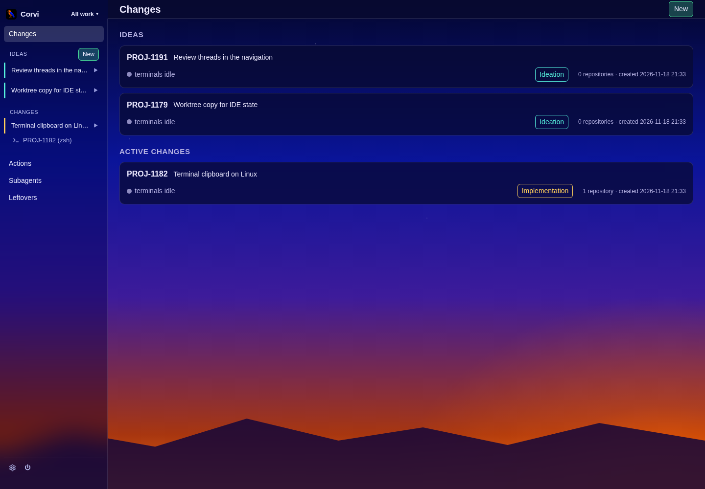

# The interface



## Navigation

At the top of the left column is the brand row: the raven, **Corvi**, and the workspace switcher.
Below it are the change overview, ideas, active changes and their terminal windows. A waiting
agent shows as the change's dot in the list and on its terminal tab, not as an entry of its own.
At the bottom sit Settings — a gear — the power control (see [Power down when
done](terminals.md#power-down-when-done)), the terminal host's restart icon, and the update icon:
yellow when a new version of the app is waiting, grey when there is none, and absent when this run
cannot update itself (see
[install](install.md#updates)). The restart icon is absent unless the running terminal host is not
the one this server would have started — another checkout's, or another build's — and it asks
before it ends anything (see [terminals](terminals.md#sessions-and-attachment)). The column is
resizable and remembers
its width in the browser. On a narrow window it becomes an overlay drawer instead: a toggle opens
and closes it, as do choosing something, clicking the backdrop, pressing Escape, and widening the
window. While it is closed the content owns the window, rather than sitting below the column.

Ideas are separate from work in progress. An unfinished wizard appears as **New idea** or the
title you typed; opening it restores its draft. Only one destination is highlighted: a terminal
window, a change view, or the draft being edited.

Selecting a change opens its **Plan** — the first of its views. **Plan**, **Dashboard** and
**Changes** are views of that change; its terminal windows are tabs in the same row and
can also be opened directly from the navigation column. Each view has a URL, so deep links,
reload, and browser Back work.
Coming back to a change's overview — from a terminal window, or by opening the change again —
lands on the view you last had open there, within the running app: restarting opens the plan
again. Leaving Settings with unsaved edits asks first however you go — clicking or Back — see
[configuration](configuration.md).

Opening a dashboard does not start a terminal. A terminal starts or attaches when opened. The
new-window control creates another window, normally in the current window's working directory, and
makes it the current one. Background work that opens a window — an action run, a subagent — leaves
the terminal you are looking at selected.

A remote workspace that cannot be reached stays selectable in the workspace menu; the menu and
the selected workspace's label suffix it **(Unavailable)**, while its retained changes, windows
and subagent entries stay in the navigation column without a suffix of their own. Its last known
data is what you see until it recovers (see
[configuration](configuration.md#remote-workspaces-that-are-unavailable)).

## Settings

The settings page edits the config file directly; [configuration](configuration.md) documents the
keys and the scopes. Its scope bar holds **Global** and one tab per workspace, and the sections
below the tabs depend on the scope. Four sections behave differently from the settings around
them:

- **Appearance** (global scope): the four themes, applied as soon as one is picked. The choice
  belongs to this device, not to the config file, so this section has no **Save**; see
  [Themes](#themes).
- **Remote access** (global scope): **Enable remote access** and the listener's **Port** ride the
draft and are written by **Save**. The Tailscale block publishes the listener to the tailnet —
**Publish to Tailscale** / **Stop publishing** — shows the published URL, and says why it cannot
publish (not installed, not connected, 443 already in use, or a 443 tree shared with another
handler, in which case it spells out the manual `tailscale serve --https=443 off`). See
[remote access](install.md#remote-access).
- **Devices** (global scope): create a short-lived, single-use **pairing code** — shown with its
countdown — and list the paired devices with **Revoke**. No token is ever displayed. See
[remote access](install.md#remote-access).
- A **remote workspace**'s **Context** tab (one workspace scope): ticking **Hosted on another
server** drops that workspace's local settings and shows its **Remote address**, **Remote
workspace** and **Device token** fields, a **Pair** control (a pairing code and a device name)
that runs the pairing against that server and fills the token, and — once paired — a picker of the
remote's workspaces. Changing the address or the remote workspace id while a token is stored warns
that the stored token no longer applies, and **Save** drops it, so the new target has to be paired
again. A remote workspace has no other sections, because its settings live on the server that
hosts it. Unticking the box switches it back to local; **Remove this context** deletes it. See
[workspaces](configuration.md#workspaces).

## Themes


Corvi ships four dark themes, chosen in **Settings → Appearance**:

- **Dusk** (the default): the dusk sky behind frosted panels.
- **Ultramarine**: a solid ultramarine navigation column, a deep-navy page and translucent blue
  cards.
- **Raven Black**: pure black, with colour as solid blocks — the selection ultramarine, what wants
  you orange, and a change's state a filled chip.
- **Spaces**: every change lights the page with its own colour pair, derived from its id. Ideas and
  the changes overview keep Corvi's own pair — ultramarine and orange.

The choice is per device rather than part of `config.json`: it is kept in a browser cookie, so it
applies to this browser on this machine and survives a restart. Picking a theme applies it at once;
another tab that is already open keeps the theme it loaded with until it is reloaded.

A theme is a set of the design tokens in `apps/web/src/app-root/styles.css`, and that file is the
only place a colour is written down. All four themes are dark (`color-scheme: dark`). A terminal's
well stays opaque in every theme, and the menus and find bar that float over it are opaque too, so
no backdrop blur runs behind a terminal. In Dusk the sky moves with the pointer, by at most 12 by 8
pixels; reduced motion — including switching that preference on mid-session — stops it. In Spaces,
switching changes glides from one pair to the next, while arriving at a change from a cold link
paints its colour instead of animating it.

## Change views

Every change page begins with a **title row**: the change's name, id and branch on the left, and
its state selector and **Actions** menu on the right — a finished change shows how it ended and,
when cancelled, **Reopen** instead of that menu. Renaming is the menu's **Rename change**
entry, which opens a field in place of the name. Under the title row is the change's one **tab
row**: **Plan**, **Dashboard**, **Changes** and any other tab an extension contributes, a
separator, then the change's terminal windows with their status marks and **+** for a new window.
In the desktop app the title row is the window's title bar — the part you drag the window by — and
the tab row under it is not part of that drag area. The **Plan** tab is
`PLAN.md` as Markdown source filling the tab — the markup stays visible, in a monospace face,
colored as an editor colors it. Tab indents in the editor (Escape, then Tab, moves focus on
instead). The text follows the file when it changes outside Corvi — an agent or an IDE editing
it — and when edits are in flight it asks before either version goes away. How far into the plan
you were is remembered as you move around, within the running app. The dashboard places notes
documents in the left column and status cards in the right; narrow windows stack the documents
first. Its columns run to the bottom of the window and the last card in each grows into the
leftover height, so the page does not end in an empty band under the cards; a wrapped tab row, a
notice or an error banner takes its height from the cards rather than pushing them past the
window. Status cards load independently, so one slow integration does not block the whole page.
The dashboard's **Subagents** card lists the change's subagent sessions, attached or not: each row
says whether its window is live and how busy it is, and carries the one action it
needs — **Open** a closed one, **Close** a live one, **Continue** an interrupted turn. Open brings
the recreated window to the front and takes you to the terminal page, where the subagent is an
ordinary window of the change. A change with no subagents has no card. Returning to a view can
show cached data while it refreshes.

When the workspace a page shows is unavailable, one banner row sits above the content naming it
and its reason, with **Retry now** and **Local settings**. Below it the retained data stays
readable and read-only, under that banner: the overview cards and the change header carry the
stale marker, and everything else — documents, cards, windows and the subagent card — keeps its last
known state without a marker of its own. Nothing is emptied. A draft typed before the connection
was lost is held (the plan and notes editors become read-only), and recovery does not itself save
it: resuming the edit, or an explicit save, follows the normal save policy. The change's phase
selector and the action menus are held back until it recovers.

The title row's **Actions** menu is the change's and the window's at once: the change's endings
first, then the actions that fit the window you are on — a prompt for the agent window you are
looking at, a command for a plain shell — and the terminal cheat sheet. Each
action is a file on disk; the **Actions** and **Subagents** pages list
these files and say where they live, with a **Repositories** block per active change: pick the
change, see what its checkouts carry, and create, edit or delete those files like any other. New
starts from a template — blank, or a copy of a built-in with its text previewed.

The overview and navigation show facts such as active pipelines, active terminal processes, and
review threads waiting on you. Colored indicators summarize status; the change's lifecycle state
is a separate choice, not inferred from those tools.

## Desktop and browser

The desktop application uses the same page as a browser, with native window controls,
notifications, dialogs, and external-link handling. The change's title row is its draggable area,
and the top of the navigation column — the brand row — is dragged the same way. Interactive
controls in both stay clickable. On macOS the traffic lights occupy reserved space at the top of
the column, and the brand row begins to their right. Renaming a change belongs in that change's
title row, not in the window's general title area.

The context-menu setting controls the browser/desktop right-click menu, including the terminal's
own menu and a window tab's menu. See [terminals](terminals.md) for keyboard and clipboard
shortcuts.

## Checking the interface

Developer commands:

```sh
bunx playwright install chromium
bun run shot
CORVI_ENGINE=webkit bun run shot
bun run app:permissions
bun run app:run
bun run app:drive
bun run app:drive --shot --notify
bun run app:sandbox 4090 --open
```

Screenshots use `CORVI_URL` (default `http://127.0.0.1:4000`) and are written under `shots/`.
Besides the wizard, settings and file pages, the harness captures a change's dashboard in each of
the four themes, its terminal page and the Appearance section; those need a change on the instance
(seed an isolated one), and are skipped when there is none. It drives the page in a browser, so it
does not capture the native macOS title bar — that needs the app on macOS.
Chromium is the primary engine because Electron uses it. Optional WebKit checks require a
working Playwright WebKit installation.

**Never test against the installed app.** Use isolated data and an explicitly owned development
server. A desktop sandbox must have its own identity; copying an installed bundle while retaining
its application identifier can address the wrong running app. Check each tool's target before
using it. Native window/notification behavior still needs platform-specific verification.

For automated suite setup and cleanup, follow the [testing guide](../guides/testing.md).
