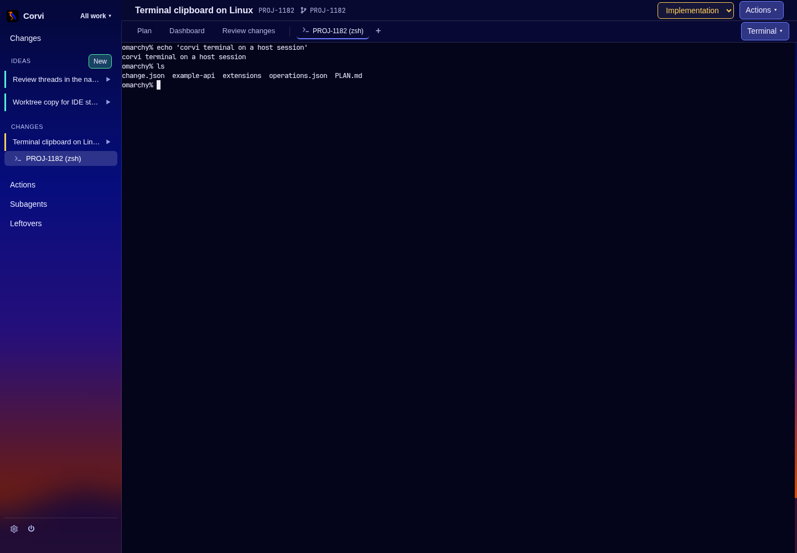

# Terminals



## Sessions and attachment

Each change's terminals are **host sessions** in the terminal host: one long-lived process per
Corvi state directory (`host.sock`) that owns the ptys. The page attaches over a WebSocket and
renders with xterm.js.

A window is created only by an explicit open: the **+** dialog, or background work — an action run,
a subagent, a split. Arriving at a change's terminal view attaches to the window the change already
has and starts nothing; a change with none shows only **+** and a line saying there is no terminal
yet, with that **+** as the way in. Opening a dashboard starts nothing either. Closing the page or
restarting Corvi detaches without losing shells: the host outlives the server that started it, so
the shells keep running and the next page resumes them (restoring the scrollback from the screen
the server keeps, which also survives a Corvi restart). Completing or cancelling a change
explicitly stops its sessions before archiving
it.

One host serves one state directory, so every checkout on this machine shares it. When the running
host is not the one this server would have started — it was started by another checkout, or by
another build — the server keeps it and says so instead of replacing it: a replacement ends every
shell, agent and action run inside it. An icon in the navigation column's bottom row appears while
that is the case, in the same yellow as an available update; it opens a question that names the
difference, counts what a restart would close, and only then restarts. Nothing else ever replaces
it: an out-of-date host with nothing running inside it is still the user's to restart.

One window holds a session at a time. Opening the same terminal in a second window attaches there
and tells the first window it has been taken over: the first keeps its last screen, says the
terminal is open in another window, and offers **Take over** — which re-attaches it and, in turn,
detaches the second. This also covers two tabs on one machine; neither screen freezes silently.

Detached is not ended, and ended is not detached: a taken-over pane says the terminal is open in
another window and offers **Take over**, while a pane whose shell exited says only that this
pane's shell ended. A socket that closes on its own is neither — it is a connection state that
reconnects. The browser socket is not the shell: within one change, a hidden pane that stays
mounted may keep its attachment (switching between the change's views generally does not
reconnect it), but leaving the change or unmounting the pane can close the socket while the shells
survive in the host and the server keeps the screen; both are resumed on the next attach, and the
screen comes back through the store across a server restart. An unavailable workspace or a
retargeted target disconnects the pane; completing or cancelling a change explicitly ends the
sessions it owns (see
[completing a change](changes.md#completing-a-change)).

A remote workspace's terminals are unavailable with it: the pane says the workspace cannot be
reached, closes its browser connection, and typing goes nowhere until it recovers; the retained
windows and their last screens stay listed. Recovery re-attaches in place, without a reload.

A terminal that is starting or reconnecting says so; the pane does not claim the shells are lost.
A shell that exits ends only its own pane and says that there — the other terminals in the change
are unaffected. A slow startup or a temporarily unreachable server is a connection state, not a
lost session, so it recovers when the answer arrives without a reload.

This persistence is not a promise to restore processes after a machine reboot or to resume an
agent conversation. Those are separate planned capabilities.

A change in a remote workspace has terminals too, with one difference: its host session — the
shell, the CLIs, and any agent — runs on the **remote** machine. The page attaches to it through
the local client's gateway, and the scrollback the server keeps is the remote server's. The
window tabs, the status channel, and attaching all work the same way wherever the session runs.

## Windows and navigation

Windows appear under their change in the navigation column and as tabs in the change's one tab
row, after its views. A default label is where the shell is, named relative to the change —
`corvi`,
`corvi/packages/terminals` — with the process in its foreground in brackets: `corvi (gradle)` while
a build runs, `corvi (zsh)` at a prompt. The place is the directory the shell announces as you
`cd`, so it stays put while a command takes the terminal's own title over. A shell that announces
no directory is named by its terminal title instead, and then by the window's directory. An
action's label or an agent's own session name wins over both, and a name you gave wins over
everything. There is no session manager underneath — a window *is* a host session, and the tabs
switch between them. The views and the windows are one bar: when more windows exist than fit,
they wrap onto another line at the row's left edge instead of showing a horizontal scrollbar, and
the row grows with them. The window's actions — the ones that fit the window you are on, and the
terminal cheat sheet — are entries of the change's **Actions** menu in the title row.

The **+** at the start of the window group creates another host session in the current window's
directory — the first one, in a change that has none — and the window it opens takes the leading
place in the row. The window tabs' leader key opens **Select terminal**: the change's windows, one
row each, with the window's icon, its name and where it is — relative to the change, or the
absolute path for a pane outside it. A digit picks a row (`0` is the tenth), the arrows walk the
list, `Enter` takes the row they are on, and a click takes the one under the pointer; `Esc` closes
the list without moving. Work that opens a window in the background — an action run, a subagent —
does not: it lands at the row's end and leaves the terminal you are looking at selected, so an idle
shell is never taken over by something you did not open. An action run pasted into a change that
has no window at all creates the one it needs. Explicitly opening a terminal — a window tab, a
notification, or a subagent entry — selects it. Keyboard focus stays with the terminal while
switching windows.

The terminal owns the screen: drag to select, the wheel or the scrollbar scrolls back, and the
right-click menu holds Copy, Paste, Select all, Clear, Find and Open link. Files and images can
be dropped or pasted in (see [Keyboard and clipboard](#keyboard-and-clipboard)). A dot indicates
output that arrived while you were looking elsewhere.

A window's name can be changed from its tab: right-click the tab and pick **Rename**. The name
replaces the default label everywhere the label is shown — the tab row, the navigation column and
notifications — and it wins over the name an action or an agent reports. A split window still says
how many panes it holds, after the name. The tab's tooltip still says where the window is and what
runs in it. An empty field restores the default. The name belongs to the window rather than to the
shell in it, so a reload, a server restart and a Corvi restart keep it, while closing the window's
last pane takes it with the window. The tab's menu follows the `contextMenu` setting: with
right-click menus turned off it does not open, and neither does the terminal's own menu.

## Agent status and the reporter protocol

An agent can say what it is doing in its session: **working** or **waiting** for you (a subagent
waits for its orchestrator), who it is, what the session is called, and the first sentence of its
last answer. Corvi uses that instead of the process name — `node` says nothing, and an idle agent
is not counted as active work just because its process still exists.

The facts are the reporter protocol. A reporter is a small plugin inside the agent; the two
included ones are `integrations/pi` and `integrations/opencode`. The reporter publishes through
the Corvi CLI (`corvi status working --name pi --session-name … --message …`), which posts to the
server; identity is the pty environment the terminal host seeds (`CORVI_SESSION_ID`), so any
Corvi session — an interactive shell, an action run, a subagent — reports the same way. A program
that cannot run the CLI may instead write the same facts as an OSC 1337 `corvi=<base64 json>`
sequence, which the host parses and the server treats as a fallback. Status belongs to a session,
not a pane; a crashed agent's status is cleared when its host session ends.

| Fact | Values | Meaning |
| --- | --- | --- |
| status | `working` \| `waiting` | working: a run is in flight or retrying. waiting: settled and idle — it wants you, unless it is a subagent, which wants its orchestrator (see [Attention notifications](#attention-notifications)). |
| name | `pi` \| `opencode` | which agent reports from this session. |
| session name | free text | the session's own name, once the agent has one. |
| message | free text | the first sentence (at most 180 characters) of the last answer. |

Corvi's window tabs read those facts (as the `@agent_*` window options the presenter declares),
through the CLI/HTTP store first and the host's OSC parse as the fallback: the session name
becomes the window's label, the status colours the icon and decides whether a notification is
owed (the edge from working to waiting, except for a subagent — see [Attention
notifications](#attention-notifications)), and the last sentence is the note beside the name. A
session whose reporter has not spoken — an old plugin, a plain shell — is presented as the
terminal it plainly is. Anything else may read the facts too (the `corvi status` endpoint): the
protocol is stated here for the included reporters, not as an extension mechanism for Corvi.

What marks each state, per reporter: pi's `agent_start` is working and `agent_settled` is waiting
(a retry or a compaction is not settled). For opencode, message activity and busy/retry are
working, and idle is waiting; a subagent's own child session says nothing about the window. For
both, an error that wants the user reads as `waiting`, and every option is cleared when the
agent's session ends.

The included reporters are installed into pi and opencode with:

```sh
bun run extension:install:pi         # retires an older global pi install (no longer needed)
bun run extension:install:opencode   # or: bun run extension:uninstall:opencode
```

These commands install Corvi's adapters into the agents; they do not install third-party code into
Corvi. Each install points at `integrations/<agent>/src` — its entry `index.ts` composing the
reporter (`agent-state.ts`), the subagent relay (`turns.ts`), and the CLI guide (`cli-guide.ts`, a
sentence about `corvi` in the agent's prompt inside a Corvi session and nowhere else) — in the shape
that agent's loader
resolves. pi's extension is no longer installed globally: every Corvi pane gets a generated agent
directory (see [harness profiles](configuration.md#harnesses-and-harness-profiles)) that adds Corvi's own extension, so
`extension:install:pi` only removes an older `~/.pi/agent/extensions/corvi/` link. opencode
follows the link to the entry and finds its modules at the real file, so its install is the one
link `~/.config/opencode/plugin/corvi.ts`. Older shapes are removed on install. Installing from another
checkout repoints the links, so do not run it as an incidental test. A real file at the
destination is left alone. pi picks a changed extension up with `/reload` or a new session;
opencode takes a restart.

An extension's own errors — a failed `corvi` command, a report that could not be published — are
Corvi's problem, not the agent's conversation, so they go to the app's log
(`~/.local/state/corvi/log`, the same file the app pipes the server's output into, seeded into
every pane as `CORVI_LOG`) instead of onto the pane's screen. Outside a Corvi session the
extensions fall back to stderr. The agent's own output is never touched.

## Keyboard and clipboard

- Shift-Enter, Ctrl-Enter, and their combination are sent using extended key sequences for
  applications that support them. Shift-Tab also passes through.
- The terminal owns the screen: drag to select (double-click a word, triple-click a line), and the
  wheel or the scrollbar scrolls back. The right-click menu offers Copy, Paste, Select all, Clear,
  Find and Open link; middle-click pastes. When a mouse-aware program (pi) is running, hold
  **Shift** (Linux) or **Option** (macOS) while dragging to select.
- Copy with Ctrl-Shift-C or the platform's command key (Cmd-C on macOS, Super-C on Linux), or the
  terminal convention Ctrl-Insert; paste with Ctrl-Shift-V or Cmd-V / Super-V, or Shift-Insert.
  Ctrl-C remains the shell's interrupt shortcut.
- Pasting puts the clipboard's text into the terminal. When the clipboard holds an image (a
  screenshot) and no text, the paste uploads it and pastes its path instead; text wins when both
  are there. A file copied in a file manager is not handed to the page by the browser, so drop it
  instead. Plain Ctrl-V is not a paste: it reaches the program as `^V`, which is how pi reads the
  clipboard of the machine it runs on by itself.
- A drop or a paste belongs to the terminal it was made on. Switching to another terminal while the
  clipboard is being read, while the size question is open, or before an upload finishes does not
  type anything into the one you switched to: the question closes, and an upload's path is offered
  to copy instead. A terminal that has ended, is open in another window or cannot be reached takes
  no drop or paste.
- Dropping files onto the terminal uploads them and pastes their paths, quoted for the shell and
  followed by a space — what a native terminal pastes for a drop, and what pi and other agents
  read as an attachment. Dropped text is pasted as text. A folder cannot be dropped. Above 200 MB
  in one drop or paste, Corvi asks before uploading. A failed upload says why and pastes nothing;
  each such message stays until you dismiss it. A file dropped anywhere else in the window is
  refused rather than opened by another program.
- Uploads are stored in the change's directory, in `.attachments/` beside its checkouts and never
  inside a repository, on the machine the terminal runs on — the remote one for a remote
  workspace, so the path works for the program that reads it. A name that is taken gets a number
  (`shot-1.png`); a clipboard image is named `paste-<date>-<time>.png`. Nothing is pruned while
  the change is open; the files travel with the change into the archive.
- Programs can show images: the terminal draws kitty graphics, SIXEL and iTerm2's inline images.
  Every pane is started with `PI_IMAGE_PROTOCOL=kitty`, the one pi's fullscreen mode draws, unless
  a harness profile or your environment already sets it (pi turns iTerm2 images off in
  fullscreen). Images are drawn by the page that saw them arrive, and the screen a reattach
  replays has none. Coming back to a window in the same page keeps its kitty images: the program
  that drew them is resized by one column and back, and pi answers by placing them again — the
  brief wiggle you may see. A reload or taking a terminal over starts without them, as do other
  image kinds, until the program draws them again.
- Cmd/Ctrl-F finds in the terminal, Cmd/Ctrl +/-/0 changes the font size, and Cmd/Ctrl-click opens
  a link. The font itself, and the Nerd Fonts icons programs print, are described under
  [Monospace font](interface.md#monospace-font).

## Attention notifications

A transition from working to waiting can notify you when you are not actively looking at that
window. Selecting the same change is not enough to suppress it if another view/window is active.
A subagent never notifies: its settled turn is waiting for its orchestrator (`corvi subagent
await`, the dashboard's subagent card), not for you, so it raises no attention edge — the window
tab and the subagent card still show its state. Notification sound is configurable. With no connected page,
there is no server-side OS notifier.
Several waiting windows can notify separately; each uses a stable window identity.

A change in a remote workspace notifies too. Its notice carries the source it came from, so the
toast names that server (`source · change`) and the banner and the click both keep it apart from a
local change that happens to share an id; clicking opens that remote change's window.

## Power down when done

Arm a machine to power itself off once no agent on it is working — start a long agent run, tick
**Power down when done**, and walk away. The control is the power icon in the navigation column's
bottom row, beside Settings and the update icon. It lists this machine and any remote workspaces;
this machine is ticked already and remotes are opt-in. Each machine shows the agents it reports
right now, each marked **working** or **waiting / done**, so you can confirm the reporters are
there before arming.

Only a **working** agent — or a subagent that is working — blocks the power-off. A waiting or
finished agent does not, and neither does a plain command — a build or a test run in another
window is ignored. An agent without the reporter extension looks like a plain process and is
invisible to this, exactly as it is to [attention
notifications](#attention-notifications), so arm a machine only when the agents it lists are the
ones you started.

Arming starts a 60-second countdown as soon as the machine is quiet. The dialog shows the
countdown, but the armed machine's own server owns it, so it runs whether or not a page is open.
If an agent starts working during the countdown, the countdown is cancelled and a new one begins
when the machine is quiet again. **Disarm** cancels it — from this control, or from a remote's own
server.

If the power command itself fails — a denied `systemctl`, or a macOS permission prompt you
dismissed — the dialog shows the reason and the machine is left disarmed. It does not retry, so a
refused shutdown is visible rather than silent, and you can arm it again.

Each remote workspace runs its own Corvi server on its own machine. Arming a remote sends it the
same command, and it powers *that* machine off using *its* own agents; this page only reads their
state through the gateway. A machine whose state cannot be read is shown as un-armable and cannot
be ticked, so a failure to see its agents never arms a blind power-off.

Shutdown only: the machine powers off, it does not sleep. On macOS the first power-off may raise a
one-time permission prompt for System Events; approve it, or the command does not run. The
countdown lives with the server: closing the app's window stops the local server and disarms it.

## Troubleshooting and safety

The terminal host owns every pty. Its socket is `<state dir>/corvi/host.sock` (the state dir is
`$XDG_STATE_HOME/corvi` unless overridden), and the window registry is `terminal-windows.json`
beside it. A blank browser terminal with a live host session points to the connection or rendering
path rather than lost shells; the pane's own starting/connecting/reconnecting state says which,
and a message that a shell ended appears only when the session really exited. Check the correct
server's logs and the browser console. Stopping Corvi and starting it again leaves the host and its
shells running by design.

Tests isolate themselves with their own state directory (`XDG_STATE_HOME`), so they never touch
your host. Follow the contributor [resource-safety
rules](../guides/testing.md#resource-safety) when diagnosing test leftovers.

## New terminal

The `+` tab (and its leader key) opens one dialog for every new terminal. `1` or `Enter` starts a
**Shell** with the change's user harness profile in its environment; `2` or `↓` then `Enter`
starts the program directly — Pi or opencode — in a new window named after the harness profile. The
dialog remembers the last
directory and profile you chose. The directory list always offers the **current pane's** directory
(the default), the **change root**, and each checkout as distinct choices; the profile list names
the change's default and is disabled while Shell is selected, because a shell always uses the
change's user harness profile. The dialog owns its keys while it is open: `Esc` closes it. Opened from its
leader key it shows those keys beside the choices and in its footer; opened with the pointer it
does not, because a key hint there is a second set of instructions for a choice already being
made. Every tab carries the harness profile it runs under.
